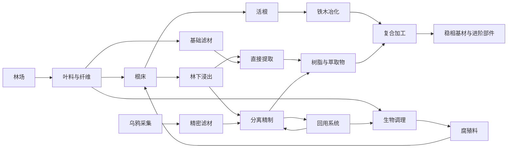

# 暮色生态产线：环境供料、二次加工与工程优化

> 2026-11-14 归档：旧生态产线提案已停止推进。用户最终确定暮色仅提供弹力打包工具与发运终端两项升级，现行规格见 [暮色收尾与 Alex 洞穴发运](twilight-dispatch-upgrade.md)。下文保留历史设计，不作为当前配方、科技树或实现目标。林地原型的实现、注册、配方和专项测试均已删除。

状态：2026-11-07 设计提案，尚未实现。目标为暮色森林增加 **20～30 小时的主动工业游玩**，不计原模组的首领、迷宫与探索流程；时长是试玩目标，不是配方等待时间或已测结果。名称、工艺和验收数值均待原型验证。

最新前期边界与展开见 [暮色初入](twilight-first-arrival.md)：主世界设备与材料单向支援暮色，新品先服务暮色采集、耗材与区域工艺。本文的整包后续部件用途保留为后期候选，不用于前期向主世界工业提供优惠材料或增产。

方向更新：先完成的 [暮色全流程调查](twilight-progression-survey.md) 作为后续分期依据。下面六条产线与五阶段时间表保留为候选，须沿“娜迦—巫妖—三分支—高地汇合—当前毕业”重新组织，暂不按原候选章节推进实现。调查已确认种树产活根、骨粉恢复浆果、早期钢叶和魔法树苗来源，优先复用原生机制。

本方案深化 [暮色资源调查](twilight-industrial-branch.md) 与 [共振工业](twilight-resonance-industry.md) 的供料和生产部分；原有冒险捷径、独立工业替代和战斗设备仍属可选提案。工业考核遵循 [工业能力考核规则](../gameplay/industrial-assessment.md)。不在本轮确定第三修复碎片的配方或七碎片能力分配。

## 1. 玩家应该遇到的新问题

六洞穴的现有循环已大量采用“取样后用搅拌、压块等机器持续重建材料”。暮色继续沿用这种结构，即使增加材料名和机器数，也很难改变体验。暮色的核心体验改为：**经营不同来源，选择加工路线，把一座能运行的工厂改造成资源效率更高、能适应需求变化的工厂。**

- 原材料来自林地、水与根系接触环境、活体生物及工业副产物。最初采集能启动生产，但长期大宗供应需要现场经营。
- 环境约束主要放在采集端；原料可运输、储存，二次加工可在玩家选择的工厂进行。只有与暮色环境有关的采集需要现场运行，不要求所有机器留在暮色。
- 高性能来自更高收率、有效回用、减少重复处理和协调共享物料。允许扩建，但复制低效单元不能改善单位产品的原料、能源与实体成本。
- 基础路线完整可用。精制路线给出真实可比较的收益，不通过故意把基础路线拖慢、重复维护或不可观察的随机故障制造需求。
- 自增可以作为少数启动或补料工艺，但不得成为所有暮色材料的通用来源。样本、加工催化物和原料必须区分，不能用“一份环境样本永久复制全部材料”替代环境生产。

## 2. 当前机制证据与设计边界

本轮读取 `manifest/mods.json`、暮色配置、现有 KubeJS、FTB 任务和 RPM Limit 配置/源码；同时检查本机缓存的 Twilight Forest 4.3.2508 映射 Jar 中的 JSON 数据。Jar 数据能证明以下掉落和配方定义，不能证明完整包运行时获取、机器兼容或区域可达性。

| 来源 | 本轮确认的事实 | 不能据此宣称的功能 |
| --- | --- | --- |
| 暮色森林 | 清单锁定 4.3.2508；禁用原生传送门，已有第二修复后的包裹发运路线 | 各候选生境都能无进度保护到达 |
| 鹿、野猪 | 鹿掉皮革和鹿肉；野猪主要掉猪肉 | 自动产酶、翻耕、喂食后的工业产出 |
| 乌鸦 | 实体掉落表含 `twilightforest:raven_feather` | 存活时周期换羽、原生自动养殖 |
| 大角羊 | 实体掉落引用原版羊掉落表 | 部署器剪毛兼容、特制工业纤维 |
| 萤火虫、蝉 | 有方块掉落表与罐装配方 | 把同名物品当成可用生物打包的活体实体，或原生生成工业液体 |
| 铁木与活根 | 活根、粗铁和金粒可合成 2 粗铁木；后续全流程调查已确认树苗生长接入地下活根生成 | 自动林场的净产率、介质条件与机械采根兼容 |
| Create、Mekanism | 清单分别为 6.0.8、10.4.16.80，仓库已有混合、压制、注液等工艺 | 普通配方 JSON 自动检查维度、生境、存活动物或生产效率 |
| FTB Quests | 已有基础机器/材料引导；第三碎片当前为精密构件富化，任务检查物品 | 持有物能证明自动化、稳定生产或效率提升 |

CMP 清单固定为 `0.6.1-dimensionworks.14`。本轮检查了该固定 tag 的 [MobilePackager.java](https://github.com/szx-jn/Create-Mobile-Packages/blob/1.20.1-0.6.1-dimensionworks.14/src/main/java/de/theidler/create_mobile_packages/items/mobile_packager/MobilePackager.java)：打包路径保存实体 NBT（含 Forge 持久数据），将实体转入包裹并移除原实体。它为运送动物提供基础；新工业状态跨打包、拆包、自动化释放后的保留仍需实测。不能用本机另一个版本的源码代替清单版本验证。

以下野猪调理、乌鸦换羽、专用浸出与回用性能及计量是候选新增机制；活根林业与浆果补骨粉已有原生路径。先检查已有农业附属与接口，能复用就复用；本轮不添加依赖，不修改第三方源码，不承诺 KubeJS 配方足以实现所有行为。

## 3. 六条相互连接、操作方式不同的产线

首轮重点放在三类源头与两类深加工，加上回用系统。原料和中间物名称为暂定，不为凑游玩时间给每个箭头新增物品。

| 产线 | 来源与工艺目标 | 玩家需要解决的问题 | 长期用途 |
| --- | --- | --- | --- |
| 林地根材 | 林业/环境：暮色叶料、供水与腐殖料维持根床，产活根与粗根浆 | 林场回种、根床补料、木料与叶料分流；采矿活根可启动，不能取代长期维护根床 | 铁木原料、纤维载体 |
| 林下浸出 | 环境/流体：水接触受支持的根床、植物与湿地条件，经采集端输出稀浸出液 | 选址或建设接触床，控制供水和原料更新；把大体积稀料就地浓缩，还是运回总厂 | 树脂、光性萃取物的共同原料 |
| 生物调理 | 生物：少量野猪在投喂工位处理叶料、植物残渣与水，产腐殖料 | 饲料与待处理料配比、工位轮换、回收物流；动物数超过料床处理能力不会继续增产 | 根床更新、废纤维再处理 |
| 精密滤材 | 生物/二次加工：乌鸦羽毛与木质纤维清洗、浸渍、压制成滤材 | 羽毛采集与纤维供应速率不同，安排批次与再生；基础纤维滤材有完整替代路线 | 浸出液分离、精制循环 |
| 铁木复合 | 化学/机械二次加工：粗铁木冶化后，与树脂和纤维经过浸渍、固化、压合 | 同一批树脂在复合材和滤材之间如何分配；提高回用后究竟该缩哪条上游线 | 暮色稳相基材、现场采集设备的进阶部件 |
| 副产物回用 | 工业回收：分离残渣、废滤材和余液分别处理，再回到受支持的输入 | 区分能回收的东西，避免一条满仓回流堵住全厂；不能把所有废物统称为通用残渣 | 降低新料、供水和动物需求 |

### 3.1 林地与浸出：环境应该能被经营

环境采集端使用固定、可见的接触床和有限范围检查。候选条件包括暮色维度、受支持植物/根床、供水、局部遮蔽或光照。正式规则必须少而明确，给出当前缺失条件；不要求隐藏的温湿度模拟，不逐 tick 搜索天然森林。

自然林地提供方便的起点；玩家也能在普通、可达的暮色区域建设人工接触床。搬运植物不能把暮色现场采集变成主世界自增。自然优质生境可降低补料或浓缩成本，但不能成为随机找不到就无法进步的唯一地点。首轮不把黑暗森林中心、冰川、高地或首领保护区域设为必需生境；具体可达区域先实测再加入白名单。

萤火虫或蝉方块可作为可选采集组件候选，使用有限数量，不按周围摆放数量无上限乘产量。光性原料可以来自火炬浆果与浸出液加工；保留已有浆果饮料配方。是否能复用原生采收必须先验证，不能预设植物会自行重生。

浸出液不是“放一桶水就免费生成所有材料”：需要供能、消耗实际叶料/接触床更新料和受支持的介质；产量受处理周期与有效接触床限制。扩大床和供应可提高总产量，精制与回用才改变单位成品成本。

### 3.2 生物：打包是迁场工具，养殖是生产问题

首轮只尝试野猪调理和乌鸦羽毛两种角色，不把每种暮色动物都变成一种必需掉落。鹿、大角羊等留作后续候选，避免一次引入过多常驻实体和机制。

- **野猪调理为新增行为。** 不宣称原生野猪翻耕或排出工业原料。通过投喂/工位批次结算消耗植物料、饲料与水，输出到收集容器；动物保留在世界中，玩家可以迁场。纯植物调理路线应能供基础根床，野猪路线以更少工序或更高有效收率取得优势。
- **乌鸦存活换羽为新增行为。** 使用明确投喂、栖位和采集周期，不依赖自然掉落或大量击杀。原版击杀羽毛可保留为启动/冒险来源；工业纤维滤材提供完整基础路线，精制羽毛滤材改善特定分离工序。用真实单位成本比较二者，而非把羽毛设成进度钥匙。
- 工位原型先以每种 2～4 只、合计不超过 8 只活体测试；这是性能测试起点，不是已确认最优数量或全服硬限额。没有食料、空余接触床或后段吞吐，多抓动物不会提高有效产出。
- 一个动物同一时刻只能贡献一个工位的处理；周期状态随实体持久化。打包、拆包、喂食自动化、迁移或转换不能清空本次周期后立即再次产出；具体挂点和状态读取先做 CMP 兼容原型。
- 已装箱的生物不在世界中工作，不作为库存中的无限生产催化物。玩家可以囤运输包裹，但运行产能来自实际工位、活体、供料和后续处理。

不增加饥饿死亡、随机疾病或强制每日手工照料。失败首先表现为可诊断的缺料或停机，允许自动补料和安全迁场。

### 3.3 二次加工：同一种粗料应有工艺选择

稀浸出液至少有两条完整路线：

1. **直接提取**：消耗粗料与普通纤维介质，经过现有机器处理得到可用树脂/萃取物。能独立支撑基础复合材，余液按明确用途处理或作为允许的损失排出。
2. **分离精制**：先用专用滤材分出树脂组分与光性组分，再分别浓缩或固化；回收部分余液、再生部分滤材。增加物流与控制工作，但降低每份目标产品的新料与采集需求。

优劣须同时列出成品/批、净新料、供水、能耗、处理时间、活动机器和实体占用。更多机器不自动等于高效；如果精制不能在关键成本上胜出，就调整工艺或删去无收益步骤。

不要求独立热力学模拟。供热、冷却与浓缩优先用现有机器能够表达的明确配方；无法复用的功能不能凭工艺名称假称存在。标准品与精制品若确有不同用途可用不同物品/配方，不增加随机纯度 NBT 和每批鉴定操作。

## 4. 连接方式与长期需求

回流图只表示接线方向，不能据此认定循环零消耗。实施前为每个循环写净收支：例如试算 10 份介质进入处理、取回 7 份可回用介质，则每批仍需补 3 份新介质及损耗；具体配比未经测试不能采用。滤材再生消耗清洗料/动力且有明确损失；不能仅靠反复再生净增滤材、金属或能源。

持续需求优先落在这套系统自身：根床更新消耗腐殖料，分离消耗可自动补给的滤材和清洗料，现场设备升级需要复合材。滤材按生产批次消耗，允许正常库存缓冲；不要用每分钟更换设备或停产期间损坏来制造操作负担。

稳相基材还需至少一项**有实际实现与需求的整包后续部件用途**，候选为跨维工业设备部件；具体接入另行审计现有配方，不能现在宣称已经接入。战斗耗材可补充需求，但不计入这 20～30 小时的工业完成目标。只有一次性设备升级仍不足以保证长期价值，试玩必须同时检查后续消耗是否真实有用。

物品、稳定液体和采集料可在暮色与加工基地之间流动。首轮允许玩家搬运完成，不要求尚未核实前置的跨维传输设备；后续接入已允许的专用端点，分别确认物品、流体、动力和区块加载能力，不假定运输工具自动加载两端。包裹迁场主要用于生物和设备，不能代替大宗物料物流设计。

## 5. 高性能是可比较的工程成果

保留基础、精制、回用三种可运行方案。对相同成品和相同测试窗口比较：

| 指标 | 原因 | 复制基础线的作用 |
| --- | --- | --- |
| 合格成品/分钟 | 观察整线有效吞吐，不看机器理论速率 | 能提高总量 |
| 新料、供水、净供能/成品 | 判断真实收率与循环代价 | 单位成本通常不变 |
| 活体数、活动机器数、加载区块 | 判断服务器与工厂规模成本 | 一般随扩建增加 |
| 满仓/断供后的恢复与副产物积压 | 判断是否能长期自主运行 | 复制相同堵塞不能解决问题 |

进阶工程提案：在既有厂区和供料预算内，把合格输出提高到基线的约 2 倍，或保持产量将新料成本降低约 30%；再处理一条支线减供或下游满仓。数值只是原型比较目标，先验证至少两种布局能达成再制定任务，不同时强制所有优化目标，不要求唯一模板。

预算只约束该次工程挑战的被测系统；不设置全服生物总额或禁止玩家正常扩建。玩家可以建大厂，但高效率奖励衡量单位成本，不能只提交双倍成品。切换产品需求、共享树脂供应和回流启停应是玩家可理解、可主动安排的变化，不由随机事件强制破坏工厂。

现有 FTB 物品任务只能验收交付。第一轮原型通过人工/调试计量对照真实流入、产出、存量变化和耗能，不能把清单勾选称为自动工程考核。若正式任务必须自动验证效率，需要独立实现或复用可靠的边界计量；输出箱预填料、外部灌料和库存释放必须区分。不要为整服每台机器建监控，计量范围限于玩家明确选择的测试系统。

Create、AE2、Mekanism 的基础机器教学仍使用已有引导。本章任务描述产品目标、约束和观察现象，提供逐层提示；不再考一次搅拌机、部署器或自动合成是否会用。

## 6. 20～30 小时如何产生

目标对象为已能使用基础 Create/物流设备的首次游玩者，可单人完成。已有原料与基础机器准备不重复算作暮色新增内容；普通生态样本的工业调查计入，首领与原生探索支线不计入。熟练玩家应能更快完成，不通过锁定在线时长补足差额。

| 阶段 | 新的建设与决策 | 主动游玩目标 |
| --- | --- | --- |
| 现场调查与首批出料 | 找可达林地、比较自然/人工接触床、布置采集和运输 | 2～3 h |
| 基础工厂投产 | 林地根材、直接提取、铁木复合，完成能自主补料的基础系统 | 4～5 h |
| 生物与精制接入 | 用 CMP 迁场，运行野猪调理/乌鸦采集，比较生物与完整基础替代路线 | 5～7 h |
| 回用与瓶颈改造 | 分流两种组分、再生滤材、调整共享供料，实测单位成本下降 | 5～7 h |
| 综合生产与扩展 | 新产品需求或减供挑战，整理运输与缓冲，完成效率对照及恢复测试 | 4～6 h |
| 合计 | 原型阶段预算，未试玩验证 | 20～28 h |

时长来自约五轮有新决策的建设、迁场、加工试验和改造。大批量生产等待可与下一阶段建设重叠；不要求后台挂够小时、不把漫长找稀有生境算成工业深度。若试玩只有 8～12 小时，先检查是否缺少工艺取舍和改造任务；不能直接翻倍材料量或把采集周期拉长。

第三碎片若最终关联暮色，应允许基础系统较早获得阶段成果，其后的精制与优化继续有用途；不把整个 20～30 小时全压成“做一个碎片”。当前第三修复解除矿物处理额度，**不再采用旧提案的 8→64 次/秒表述**；沿用当前效果，实际配方、进度位置和验收另行审核。启动链要在当时所有额度内验证，包括矿物处理 8 次/秒、活动机器额度与跨工序额度，不能只检查转速。

## 7. 性能、绕过与实施顺序

### 性能约束

- 普通加工优先现有机器和 KubeJS 配方。环境条件与活体批次是确有新增运行逻辑的部分；先验证现有接口后再决定对应自研模块，不先建一个通用生态模拟框架。
- 活体保留原 AI，不通过全局关闭生物行为节省成本。控制工位、有效生物数量和查询范围；试点只查询已加载的局部范围，低频检查状态，不扫描维度或相邻未加载区块。
- 环境结构检查在结构变更时失效，必要复检分摊执行；工作只在供料与输出容量满足时结算。满仓、缺料、断电停止生产，不吞输入，不持续生成掉落实体。
- 不新增强制加载；首次测试尽量把采集和工位各收敛到少数区块，记录实际加载数量。扩建要统计机器、实体、查询成本和运输两端加载，不能只统计控制器。
- 卸载与离线不结算离线产出；重载和重启恢复已有周期与库存。计量时用真实加载运行时间，不能用墙钟时间伪造产率。

### 有现实依据的绕过审查

检查 TF 的转换粉配方（本轮数据发现鹿→牛、野猪→猪、大角羊→羊、乌鸦→蝙蝠等），以及捕获/释放、其他繁殖方式、剪毛、抢夺掉落、刷怪笼、装备拆解、压块和现有自增循环。转换不能用来刷新工业周期；若普通机器已经能大量产羽毛，应把它纳入成本比较，不能只禁一种路径后声称必须养乌鸦。

暮色拆解台现有脚本已限制，但仍需审查其他转换与回收。关键新成品不放宽泛标签以免替代输入绕过深加工；再生介质的每个出口都核算，禁止闭环净生能源或金属。交易与代工可以作为多人合作，但交付材料不等于被测系统完成效率挑战。

### 首批交付顺序

1. **一个可玩的垂直原型**：林下浸出→基础提取→铁木复合，并接一个滤材回用分支；先让玩家亲自比较直接提取和精制的收益。只注册确有用途的最小材料集合，统一进入 `dimensionworks_cave_factory:main` 页签。
2. **两种生物的小规模原型**：先测 CMP 打包/拆包、受支持投喂自动化、周期持久化及单工位收支，再与植物/纤维替代路线比较。没有实际收益或运行成本过高的生物环节应调整，不强塞进主线。
3. **完整包审计与游戏验证**：导出生效配方/标签/掉落，核对前置可达性、原暮色装备与饮食配方，实测连续运行、库存满载、断供、迁场、重启、两种布局及服务器 tick 成本。
4. **试玩后确定规模和任务**：记录各阶段主动操作、等待、重复工作与完成时间；有至少两条完整解法、有可观察优化收益后，再锁定数量、节奏及碎片关联。若自动计量未交付，任务文案如实标注交付验收范围。

本轮交付为设计文档和来源核对，不代表上述产线、配方、动物行为或 20～30 小时流程已经进入游戏。
