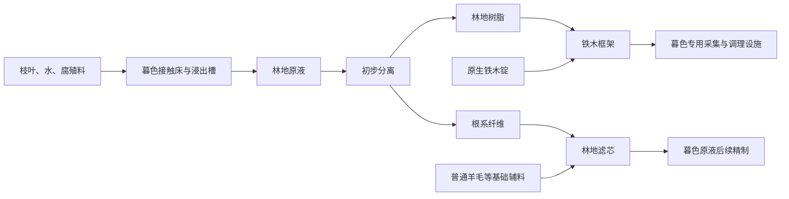

# 暮色初入：独立的林地生产体系

状态：2026-11-07 用户已确定首段方向，首版实现与服务器专项检查已完成，见 [验证记录](../validation/2026-11-07-twilight-first-production.md)。承接 [暮色全流程调查](twilight-progression-survey.md)，范围为首次进入普通森林至娜迦之前的工业起步。下文保留设计动机，实际首版配方与设施规则以第 8 节为准；整体时长与平衡仍需试玩。

2026-11-14 后续全章方向见 [暮色全套产线规划](twilight-full-production-plan.md)：保留本首段独立建设，中后期新增有助于主世界高级材料的制造路线，并用综合工业成果制造玩家发运终端升级卡。下一维度待定；下文的“后期另行讨论”由该规划承接，具体新增配方仍未定稿。

## 1. 已确定的方向

**主世界工业基础单向支援暮色，暮色前期建立自己的产品与需求。**

- 沿用玩家已经解锁的 Mekanism、Create、AE2 设备、动力、加工与仓储能力。铁、铜、玻璃、合金和食料等旧材料仍可启动与补给，不重走机器科技树，也不假定玩家拥有全部高级设备。
- 暮色新品先服务当地采集设施、专用耗材与后续区域工艺。前期不为精密构件、能量板、处理器或主世界矿物处理增加优惠路线，也不向旧机器提供增产效果。
- 新收益来自经营不同来源、获得新的当地加工能力，以及降低暮色生产成本。普通森林产品在后续区域继续有需求，形成暮色内部的长期供应体系。
- 新生产路径的独立性体现在源头、工艺组织和下游用途；不靠强迫废弃旧设备制造区别。原料可搬回主世界加工，产物仍主要供暮色使用。

以上为用户明确的方向。首段规则已经确定，实际配方见第 8 节；本轮不确定修复碎片的能力、配方或位置。后期是否接回整包终局另行讨论。

## 2. 落地所见与原生可制物

现有包裹发运寻找适合玩家进度的安全落点，没有固定的新手营地，也不保证某只动物或某个遗迹就在视野里。开场依靠普通森林中可寻找的资源。

| 所见或附近可寻找的来源 | 第一印象与用途 |
| --- | --- |
| 暮色树木、枝叶与树苗 | 地上林业仍能经营，枝叶将成为本地工艺的实际消耗料 |
| 地下普通根与活根 | 森林地下部分也是资源；活根用于铁木和接触床起步。普通根非精准采集掉木棍，不能把根、活根物品与活根方块混为一谈 |
| 洞穴或悬垂处的火炬浆果 | 可用于地图、饮料与照明；原生采摘后能用骨粉恢复，不假定自然随机长回 |
| 野猪、鹿、大角羊、乌鸦 | 可用 CMP 迁场；建议第一种工业岗位只选野猪，其他动物保留原生用途 |
| 树干上的萤火虫、蝉与环境光点 | 提供暮色氛围与营地装饰；可收集物是方块，环境光点不是可捕获实体 |

建议开场提示只说明：“带来的机器还能用。看看树根、枝叶和动物，哪些能成为这里持续工作的原料。”不添加必做研究台或逐个样本鉴定。

锁定的 Twilight Forest 4.3.2508 配方与本包数据中，玩家有材料即可尝试：

| 原生物品或已有整合配方 | 制作方式 | 开场用途 |
| --- | --- | --- |
| 魔法地图 | 乌鸦羽毛＋火炬浆果＋萤石粉制核心，再加 8 张纸 | 找主要地标，为娜迦方向规划路线 |
| 粗铁木、铁木锭 | 1 活根＋1 粗铁＋1 金粒得到 2 粗铁木，再熔炼 | 认识本地金属，供新设施使用 |
| 铁木工具与护甲 | 原生铁木装备配方 | 可选探索装备，已有主世界装备仍可继续使用 |
| 萤火虫罐、蝉罐 | 对应方块物品＋玻璃瓶 | 营地照明或装饰 |
| 火炬浆果汁 | 本包已有 8 浆果压块得到 1,000 mB 果汁 | 保留饮料用途，不直接改称工业原液 |

不要求提交全套铁木装备或收齐所有动物。地图需要羽毛，不意味着原生乌鸦已经能繁殖、自动换羽。

## 3. 第一件新增设施：林地浸出槽

粗制浸出槽用铁、铜、玻璃与已有基础结构材料制作，不消耗自身产物、精密构件或暮色高级材料。它承担环境采集：

1. 在暮色的有效根系接触床旁工作。天然根区和人工建设都应可用，不要求罕见群系或精准采集大量根方块。
2. 实际消耗枝叶、水、腐殖料与动力，输出 **林地原液**。接触床提供环境条件，不是一份样本永久复制材料。
3. 缺环境、缺料、断动力或出口满时停止并显示原因。不破坏大片天然森林，不进行全维度扫描。

人工接触床可尝试用普通泥土与少量活根制备的缠根泥土区域；建床配方、认可范围与天然床规则在原型中确定。更新料在库存中按生产批次扣除，不做随机衰败或每日手工维护。

暮色环境约束放在采集端；原液可以储运，后段加工地点由玩家选择。搬运接触床不能让浸出槽在主世界继续产原液。

## 4. 第一条加工路径与实际用途

| 新产物 | 第一项用途 | 持续需求 |
| --- | --- | --- |
| 林地原液 | 分出树脂和纤维 | 后续精制继续消耗同一种粗料，基础采集站保留价值 |
| 林地树脂 | 与铁木锭加工铁木框架 | 暮色采集头、调理设施及区域设备的结合材料 |
| 根系纤维 | 压制林地滤芯 | 暮色液体处理的消耗介质，后期研究再生 |
| 铁木框架 | 制作正式生物调理槽等本地设施 | 后续区域仍需当地框架，不替代通用坚固板或旧机器升级材料 |
| 林地滤芯 | 后续原液精制，提高有效树脂回收率 | 按处理批次消耗，可自动补给，不按现实时间腐坏 |

初步分离不消耗林地滤芯，避免先有滤芯才能产纤维的循环前置。基础线完整可用；精制增加处理与物流工作，以更高回收率降低采集需求。若没有实际收益，就修改工艺，不靠强制消耗制造需求。

初步分离优先尝试现有 Create 工作盆能表达的配方，纤维压制和框架加工沿用已有机械工序。不得凭“分离”一词宣称 Mekanism 已支持某种新原液；实施时核对实际配方、热态与容量。沿用适用的 Mekanism 和 AE2 能力，不为了凑齐三个模组增加一道工序。

后续区域设备的具体用途随对应阶段落实，本轮不编造沼泽、黑暗森林或冰川配方。第一批材料不接回主世界元件生产。

## 5. 第一种生物岗位：野猪调理

树脂与铁木框架可以制作 **生物调理槽**。CMP 迁入少量野猪，消耗枝叶、基础饲料与水，产出 **熟化腐殖料**，补给浸出槽的接触床。

这是首版新增的生物作业，不是原生野猪能力。玩家要协调待处理植物料、饲料、工位与浸出消耗，不是单纯多抓生物。

- 启动腐殖料保留植物调理的基础路线，例如枝叶与骨粉加工，避免必须先造调理槽才能启动浸出。野猪路线须在单位成本或加工负担上有可比较的收益，配比通过原型确定。
- 原型先用 2～4 只野猪测试，工位与下游需求决定有效产能；超出有效工位数量不继续增产。这是测试起点，不是全服限额。
- 输出进入容器，缺料、满仓停机；不产生周期性地面掉落，不增加饥饿死亡、疾病或每日照料。
- 同一动物只贡献一个工位；已打包的动物不工作。打包、拆包、迁场、重启不能刷新生产周期，需实测 CMP 固定版本的状态保留兼容。
- 普通羊毛可作滤芯辅料，不把大角羊专属掉落设为钥匙。鹿和乌鸦先保留原生用途，不为每种动物新增一种必需材料。

腐殖料只补给暮色环境工艺，不提供主世界增产肥料效果。第一阶段由环境采集、二次加工和活体供料构成，三者有不同的运行问题。

## 6. 玩家如何展开第一阶段

1. 找补给位置、取森林样本，顺路制作地图等原生物品。
2. 用带来的材料造粗制浸出槽，以植物路线补首批腐殖料；可在现场小试，也可把原液运回已有工厂。
3. 分离树脂与纤维，制作框架与滤芯，优先让材料变成实际设施。
4. 用框架制作调理槽，CMP 迁入野猪，让腐殖料补给接回现场；协调两种源头的供料与节奏。
5. 带已有装备探索娜迦方向，林地站继续作为暮色后续工艺的供应基地。起步不要求娜迦掉落，下一阶段再沿原生冒险骨架展开。

首段目标是一座能补料并供给后续工艺的林地原料站。不要求开场达到全章最高效率，不靠大量提交材料拖延停留；全章 20～30 小时仍是未试玩的总体目标。

本章不重教基础机器操作。若加入工业验收，遵循 [工业能力考核规则](../gameplay/industrial-assessment.md) 观察真实补料、出料和停堵恢复；持有材料只能证明交付，不能证明系统自主运行。

## 7. 物流、性能与实施边界

- 普通物品与原液可储运，初期允许携带往返。跨到暮色使用当前允许的专用端点，不能假定原生 AE2 量子桥或 Mekanism 量子纠缠传输器可跨到暮色，也不假定端点加载两端。
- 第一站收敛在少数区块，不新增强加载或离线产出。接触床只查有限局部范围，结构变更后失效并低频复检；生物工位只访问已加载局部动物。
- 原型记录机器数、活体数、加载区块与长期运行成本；验证缺料、满仓、断动力、卸载、重启、迁场和净收支。不能仅凭一个控制器声称性能好。
- 配方、标签与掉落优先 KubeJS/数据包；确需新增的环境校验和活体批次再决定实现位置。不把普通配方 JSON 当作维度或动物校验，不新增依赖或修改第三方源码。
- 新专属物品、流体容器与设备统一进入 `dimensionworks_cave_factory:main` 页签。审查标签替代、回收与现有 RPM 产量倍率，避免意外返利或闭环净增。

原生事实来自全流程调查与发行 Jar 配方静态核对。新增行为的验证结果另记，不把设计目标或编译通过当作完整游戏试玩。

## 8. 第一版实施规格

两台新设施和五种固体材料注册在现有 Cave Factory 模块，流体由 KubeJS 注册。原料与成品接入已有「维度工坊」页签；不新增模组依赖，也不改主世界工业产品配方。

| 工艺 | 首版投入 | 首版产出 |
| --- | --- | --- |
| 手工启动腐殖料 | 4 暮色树叶＋2 骨粉 | 1 熟化腐殖料 |
| 工作盆植物调理 | 8 暮色树叶＋1 骨粉＋250 mB 水 | 1 熟化腐殖料 |
| 浸出槽 | 8 暮色树叶＋1 熟化腐殖料＋1,000 mB 水 | 1,000 mB 林地原液 |
| 生物调理槽 | 8 暮色树叶＋1 胡萝卜/土豆/甜菜根＋250 mB 水；2 只成年野猪参与 | 4 熟化腐殖料 |
| 基础分离，加热工作盆 | 1,000 mB 林地原液 | 2 林地树脂＋2 根系纤维 |
| 滤芯分离，加热工作盆 | 1,000 mB 林地原液＋1 林地滤芯 | 4 林地树脂＋2 根系纤维 |
| 框架压块 | 4 铁木锭＋2 林地树脂 | 1 铁木框架 |
| 滤芯压块 | 2 根系纤维＋1 羊毛 | 2 林地滤芯 |
| 建床 | 1 活根＋4 泥土 | 4 缠根泥土 |

粗制浸出槽消耗 2 玻璃、2 铜板、1 桶、2 铁锭、1 安山合金；生物调理槽消耗 2 铁木框架、2 铜板、1 桶、3 铁锭。原生铁木配方继续保留，生物槽不会成为启动原液的循环前置。

**现场设施规则：**

- 两种设施只在暮色工作，接水平传动轴。最低 32 RPM，128 RPM 达到最大处理速度；各消耗 4 SU/RPM。首版每批需 200 标准工作刻，即 128 RPM 时 10 秒。更高 RPM 不能加快环境或动物工作。
- 浸出槽下方同一层铺满 3×3 接触床。缠根泥土、普通根方块、活根方块可混用；人工床不依赖精准采集。
- 生物槽在水平 3 格、上下 1 格附近查询成年野猪。每槽使用 2 只，同一动物不同时参与多个槽；每批结束休息 200 个实际加载刻，装箱或离线不缩短休息。
- 两个输入物品槽、一个输出物品槽，进水和原液罐各 10,000 mB。上方接物品输入，下方接产物输出，侧面接进水。水桶可灌水，空桶可取原液；空手右键打开界面。
- 出口满、缺料、缺水、缺环境、缺野猪、低转速或过载时不扣输入。红石信号暂停；生物作业中断后需重新完成本批工作，输入保留。
- 破坏或扳手拆卸时，实际掉落设施物品保存库存与液体；便携物品不带未完成工作进度。CMP 动物 NBT 路径需要保留 ForgeData 中的工位与休息信息。

接触床每秒只检查 9 个已加载方块；生物槽每秒访问局部动物，不创建加载票据、掉落物或离线结算。首版滤芯消耗后不再生，回用属于后续阶段；加工物和成本可通过 [首版配方目录](../../kubejs/data/dimensionworks_cave_factory/recipes/twilight/) 编辑。

取叶须使用剪刀或其他适用采收方式。不能把机械锯的原木、树苗产出直接当成树叶物品供应，林场自动取叶的布局仍需实际验证。
