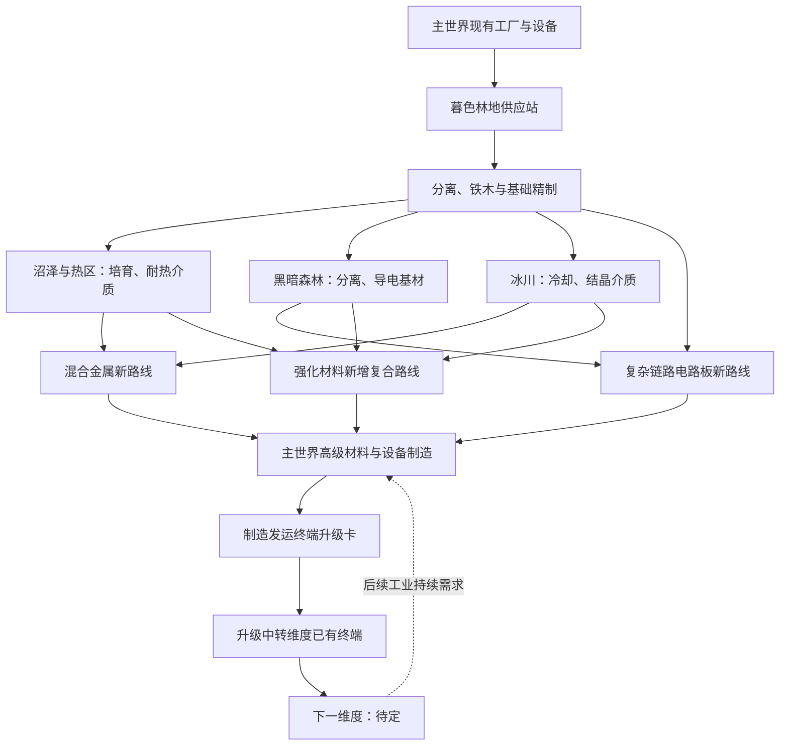

# 暮色森林全套产线规划

日期：2026-11-14。状态：整章规划草案；第 1 节记录本轮用户已明确的方向，其余新增工艺、产品名称、配方和阶段划分均为建议，尚未实现。林地起步已有实现和专项服务器检查，不能据此认为整章已完成或当前服务器已部署。

本规划统一后续实施顺序。首段现有规则继续以 [暮色初入](twilight-first-arrival.md) 为准，原生流程依据 [暮色全流程调查](twilight-progression-survey.md)。早期共振、生态与工业支线文档保留为候选资料；与本轮方向冲突的后期用途、碎片关联和阶段安排不直接采用。

## 当前阶段：先确定最终机械

2026-11-14 用户补充：暮色的独特最终成果是一组机械，能够参与加工、改变产线运行方式，并有部分机械影响周围生物。当前先确定最终机械的作用，再反推产线；下面第 3～8 节的材料路线、阶段与开发安排暂作为此前草案，不继续据此落实配方。

**首领干扰设备已从候选目录移除。** 旧共振方案的压制桩及首领干预模块不再采用。影响周围生物的设备继续讨论其实际用途，不以干扰首领作为目标。

### 命名依据

本轮核对清单锁定 Create `mc1.20.1-6.0.8` 的发行 JAR 中 `assets/create/lang/zh_cn.json` 与 `en_us.json`。从现有名称归纳命名方式，不将其称为官方发布的命名规范：

- **动作或用途＋具体部件**：注液器、打包机、动力搅拌器、动力冲压机。名称首先说明设备实际做什么。
- **处理对象＋功能**：转速控制器、流体储罐、仓储链接站。确有必要时才补充动力方式或操作特征，如动力泵、可编程齿轮箱。
- **具体、简短、能联想到方块**：石磨、粉碎轮、鼓风机、工厂仪表。并非所有设备都加“动力”，也不统一套用“站”“塔”“桩”。
- 本包沿用上述思路，不批量用“共振”“相位”“调谐”等概念词充当功能名称。暮色特色优先通过实际机制、外观和使用情境表达；需要区分同名设备时再加适当修饰。
- 方块名称应与其实际结构、作用方式一致。旋转分离明确后可叫“离心机”，喷洒药液明确后可叫“药液喷头”；不能为了名称先承诺未确定的机制。

### 方块设计先做可替代性审查

Create [官方项目说明](https://github.com/Creators-of-Create/Create/blob/mc1.20.1/dev/README.md)强调尽量把设计选择留给玩家，让可见的运动部件在不同布局中协同工作。本包据此采用自由组合与明确部件职责；**现有产线能完整替代就不得新增方块**是用户进一步明确的项目约束，见 [AGENTS.md](../../AGENTS.md#自研方块的职责与可替代性)。

一台新方块必须先回答：它作用于什么对象？执行哪一个具体动作？现有模组与产线在哪个环节做不到？玩家如何把它与已有部件组合？怎样观察运行结果？没有明确能力缺口，就不进入最终机械目录。换一种材料、改一个名字、集中 GUI 或提高效率不构成独立职责；通过削弱旧机制制造必要性也不接受。

### 已撤回的六个方块提案

用户已否定前六个提案。此前仅更改命名没有解决职责重复的问题，以下全部从最终机械目录撤回，不继续写配方或实现：

| 撤回的暂名 | 原提案的问题 | 后续处理 |
| --- | --- | --- |
| 动力反应器（原共振反应釜） | 仅以加工高级材料定义职责，未提出已有加工设备不能执行的独立动作 | 新材料配方优先接现有工作盆、装配或适用的加工设备 |
| 动力分离器（原相位分离塔） | 把多产物加工、分流与配方选择重新包装成专机 | 用现有加工输出、物品/流体分流和配方组织表达 |
| 滤材再生器（原介质再生器） | 废滤材回用本身是配方与物流，未定义不可替代的运行行为 | 在已有加工体系中设计回用，不单独加再生方块 |
| 热交换器（原热交换塔） | 没有定义具体热交换对象、独立行为及现有供热能力边界，先承诺了一台设备 | 撤回本提案；新增配方的供热优先复用现有设施，不凭热工名称增加方块 |
| 工序控制器（原工序联锁台） | 共享供料、批次与设备状态控制已有 AE、物流、红石与可编程部件可组合，未证明新职责 | 让玩家自行组织控制与调度，不提供包办产线的控制黑箱 |
| 树木培育器（原林地调谐器） | 只提出调整产物构成，没有核实独立交互或与现有林业、培育及暮色魔法树的区别 | 撤回本提案；先调查真实林业能力，不能用产量变化充当新机制 |

### 其余提案的审查状态

- **普通饲喂器也不作为最终机械。** 本包已有 Touhou Little Maid `1.5.3` 的动物繁殖任务定义；Create 的机械手实现已有实体使用交互路径。普通投喂尚未体现不可替代的动作。具体暮色动物与这些工具的兼容仍需实测，不能将尚未验证的兼容问题当作新方块的设计理由。
- **生物影响设备尚未确定。** 单纯施加已有治疗、恢复或药水效果不能自动成为独特能力；先核对原版及清单模组的组合路径。只有明确新增的生物交互职责后才讨论设备，不继续沿用“庇护站”或预先承诺“药液喷头”。
- **发运终端升级的目标保留。** 这是用户已明确的新维度通路扩展，沿用中转维度已有终端作为安装对象；升级卡/模块的载体与具体机制仍待设计，不另造一个重复的发运方块。它不是自动化物流端点，也不指定下一维度。

当前没有通过可替代性审查的新增独立机械名单，不以补足数量为由重新命名或替换被否定的提案。先明确新的世界交互与组合用途，再确定最终方块；此阶段不落实产线、配方或加工周期。现有林地设施是否满足这一标准需另按实际功能核对，本轮没有对其作出已通过审查的结论。

本轮证据范围：官方 README 与 [机械手实体交互源码](https://github.com/Creators-of-Create/Create/blob/mc1.20.1/dev/src/main/java/com/simibubi/create/content/kinetics/deployer/DeployerHandler.java)说明理念与交互路径；官方源码分支是移动来源，不作为固定版运行验证。本地清单、既有配方/能力文档，以及固定 Jar 的女仆动物繁殖任务与 Create Connected 可编程脉冲部件定义用于识别已有能力，不代表已测试所有布局或暮色生物兼容。

## 1. 已确认的目标

玩家已完成主世界产线，需要新的建设目标。暮色这一章同时交付两个结果：

1. **有助于现有工业的高级材料生产能力。** 新原料、新工艺和新增配方直接接回已有材料与设备体系，让玩家看到建设暮色工厂之后，哪些生产问题更容易解决。
2. **开启下一维度的发运终端升级卡。** 用上述高级工业能力制造升级卡，对中转维度已有的玩家发运终端使用，增加下一维度目的地。下一维度待定。

必须遵守：

- 暮色承接主世界已有设备、动力、加工与仓储，已经毕业的玩家可以直接利用自己的工业基础。
- 保留现有基础机制与可用配方，通过拓展获得收益；不为了突出暮色而削弱、删除或限速旧路线，不追溯收回已获得的进度。
- 收益以原料选择、不同工艺路径、副产物利用、可回用介质和新的制造能力体现。数量收益应有对应的物料与工艺依据；不以全局增产、转速、伤害或额度倍率作为本章主要奖励。
- 林地起步产品先服务当地建设；中后期逐步接回主世界高级材料，不要求全章毕业才得到第一项实用收益。
- 升级卡开启新内容；既有主世界、下界、末地和暮色路线继续可用。卡与物品/流体/SU 跨维传输端分属不同设备。
- 七个修复碎片的能力与配方不在本轮重新分配。暮色毕业优先使用独立的终端升级成果，不把已有第三碎片补成新的强制门槛。

## 2. 当前可复用的基础

核对时根 `VERSION` 为 `0.3.42`；清单锁定 Twilight Forest `4.3.2508`、Create `mc1.20.1-6.0.8`、Mekanism `10.4.16.80`、AE2 `15.4.10`、CMP `0.6.1-dimensionworks.15`。这些记录只描述本次仓库基线。

| 已有内容 | 可以直接承接的工作 | 实际边界 |
| --- | --- | --- |
| 林地浸出槽、野猪生物调理槽 | 现场供原液、腐殖料；建设叶料、饲料、水与动力供应 | 只在暮色工作；没有新增区域采集、其他动物岗位或负温模拟 |
| 原液基础/滤芯分离、铁木框架、林地滤芯 | 已有第一组共享物料和精制选择 | 滤芯目前直接消耗，尚无失活滤芯与再生配方 |
| 林地专项验证 | 已有 11 个配方及相关服务器 GameTest 的历史结果 | 自动取叶、完整林场、真实 CMP 操作、长期运行与完整客户端仍有未验证项 |
| Create、Mekanism、AE2 与现有物流 | 加工、自动合成、缓存、分流、按需生产 | 不为凑模组数量强制增加工序 |
| 专用一级跨维传输端 | 物品、流体、SU 的已有制造与能力接点 | 二三级尚无生存配方；端点不自动加载两端，也不自动传气体 |
| 中转维度玩家发运终端 | 保留现有位置、玩家包裹和目的地选择流程 | 天境/Alex 洞穴目前同时被客户端目录和服务端代码锁定；没有安装升级卡机制 |
| FTB Quests | 原有安山、黄铜、物流与齿轮之心引导 | 现有物品任务只能证明交付，不能证明自动化效率或连续运行 |

新增普通工艺优先 KubeJS/数据包。当前 `twilight_work` 只有 `leaching`、`conditioning` 两种岗位，输入槽还限定树叶与腐殖料/饲料；新增生境校验、冷凝设施或动物行为不能只靠写一张同类型 JSON 实现。

## 3. 玩家从开场到毕业的建设顺序

沿原生“娜迦—巫妖—三分支—高地汇合”组织章节与探索提示。三分支的施工顺序开放，支持多人分工。原生进度、奖励与区域保护继续沿用；工业配方不额外增加一套 Boss 硬锁。工业基础路线使用可持续供应，探索材料可以提供经核实的可选工艺。

| 阶段 | 玩家建什么 | 产品与直接用途 | 新的工程问题 |
| --- | --- | --- | --- |
| A 林地供应站，娜迦之前 | 自动叶料供应、浸出、植物/野猪调理、原液分离、铁木加工 | 现有树脂、纤维、腐殖料、框架和滤芯，供应后续全部分支 | 不同来源接成完整系统；解决自动取叶和供料，而非重复基础机器教学 |
| B 基础精制厂，娜迦至巫妖前后 | 滤材处理与回用、树脂/纤维分流、原生铁木自动制造 | 可回用的多孔介质与复合基材（暂定）；先改善暮色精制，再供高级电路新路线 | 提高有效回收率，避免回流满仓拖停供料；比较基础与精制方案 |
| C1 沼泽—火焰沼泽产业 | 多孔载体培育、洗涤分离、燃料供给、热处理和介质回用 | 耐热复合介质（暂定），接混合金属的新制备路线；钢叶为可选强化材料 | 热处理与上游培育共享供料；减少新料需求，安排回流和燃料缓冲 |
| C2 黑暗森林—高塔产业 | 木质/金属组分处理、吸附分离、导电基材制造与顺序装配 | 精制导电基材（暂定），接复杂链路电路板新路线；骑士金属、砷铅铁分别提供可选部件 | 同一粗料分成多个有用出口，协调不同产品订单，处理副产物和批次切换 |
| C3 积雪森林—冰川产业 | 冷源供应、显式冷却投料、结晶介质制备与分离回用 | 结晶介质（暂定），接混合金属精制、强化材料的新增复合工艺 | 冷源与热区中间物汇合，协调物品/流体批次与剩余母料回用 |
| D 高地综合厂 | 三分支供料接入同一制造网络，新增高级材料路线稳定投产 | 实际产出复杂链路处理器、下界合金碎片等已有高级材料；再制造终端升级卡 | 在多个真实产品需求间调度，判断本地加工与运输方式，并从断供/满仓恢复 |
| E 终端升级与后续经营 | 在本人中转领地终端安装卡，获得新目的地 | 下一维度通路；暮色工厂继续为高级材料供料 | 把本章制造能力带进下一章，按新的产品需求扩展原厂 |

表中的区域代表主题与正常探索安排。工业替代路线不依赖重复击杀首领；若具体采集点受到原生保护，应如实标注正常可达阶段，并保留已核实的普通来源或工业路线。不能把钢叶、魔法树苗的持有当作通过某个首领的证明。

第一批新产品只保留确有加工用途的少数介质与基材。每个中间物必须对应缓存、分离、储运、回用或成品制造的一项实际需要，避免给每个箭头注册一个物品。

图是建议的物料依赖。卡的实际配方须在新路线和目标维度确定后设计；不能让下一维度独有材料成为开启该维度的前置。

## 4. 高级材料助力：先做三个具体接点

新增配方输出已有材料 ID，下游设备直接受益。每条新路线保留原有可用路线，以整个生产系统比较投入、产出、工序、物流、能耗与操作负担。下表的新增路线是原型目标，不是已确定的可执行配方。

| 接点与优先级 | 当前仓库可确认的路线/用途 | 暮色新增路线建议 | 玩家能感受到的帮助与取舍 |
| --- | --- | --- | --- |
| P1 复杂链路电路板/处理器 | 已有设计记录为下界合金碎片压印电路板，再与硅、红石加工成处理器；`ae2omnicells:complex_link_processor` 被能量板持续消耗 | 先试复合/导电基材制造同一电路板的另一种加工路线；处理器及能量板原路线继续可用 | 允许在金属结晶供给紧张时，用林地与黑暗森林材料建立另一条电路供应。新路线消耗实际金属/导体与暮色材料；完整包内核实压印与附属加工配方后定稿 |
| P2 下界合金碎片的混合金属上游 | 现有 `kubejs:mixed_metal` 由硫酸、二氧化硫、铁、金、铜、末影粉、坚固板制备，再与带 `netherite` 特质的高压结晶装配，产 2 碎片 | 热区介质与冰川结晶介质参与另一种混合金属制备/精制，优先尝试替代部分加工辅料并产生可用回流 | 提供不同的化学辅料供应方式，让暮色承担部分上游生产。保留实际金属投入、现有特质结晶路径与旧配方；收支包括回流后的净消耗，不能借循环凭空增加金属 |
| P3 强化/原子合金 | `mekanism:alloy_reinforced`、`mekanism:alloy_atomic` 已用于 DDR、工厂升级与其他高级部件；本轮未重新核对其全部生效生产配方 | 在核对固定版本和生效配方后，试一条下级合金＋必要强化原料＋暮色处理介质的复合工艺 | 增加供料与加工选择，保留关键强化材料的真实成本。若只是加一步然后全面更差，就不交付；若无条件优于全部旧路线，应调整工艺取舍 |

**首个实用收益优先选 P1。** 能量板已连接很多 Mekanism 设备，其复杂链路处理器上游是清楚的生产接点；玩家无需等终端卡才能看到变化。P1 应在林地精制与黑暗分支投产后可用，热区/冰川的组合收益随后开放。

验收新增配方时，应回答三个问题：我多了哪种原料选择？我具体减少了哪项供料或加工压力？为此需要经营哪条暮色供应？收益可表现为真实收率提高，但必须来自新增工艺，不能只是对原机器加一个倍率。

不在本轮扩展核燃料、反应堆、全套终局材料或所有装备的新配方。先验证上述三个真实接点有价值，再依据下一维度职责追加用途。

## 5. 原生暮色资源的全套覆盖边界

完整规划覆盖生产源头、关键材料和有用成品；建筑变体、收藏与一次性奖励按资源族接入，不要求每个模型都有一条新增产线。

| 资源族 | 在产线中的安排 | 需要核实的边界 |
| --- | --- | --- |
| 暮色木、叶、树苗、活根、铁木 | 基础林业、地下采根、原生铁木制造；树脂/纤维供全章 | 自动取叶与采根、树苗净回收、介质和加载范围需实测；优先原生种树产根路径 |
| 火炬浆果与普通暮色食品 | 补给及可选介质支线；保留既有果汁用途 | 原生骨粉恢复可作为采收原型依据，自动交互兼容仍待测 |
| 野猪、鹿、大角羊、乌鸦、企鹅等 | 野猪保留已有调理；其余先接原生食品/纤维等可选供应 | 不为每种动物新增必需资源，不默认乌鸦能繁殖或存活产羽毛 |
| 钢叶 | 沼泽支线的可选多孔/复合材料；评估新增持续制造是否有实用需求 | 空心山已有早期来源，不能做迷宫进度锁；新增生产原物品前核算装备影响 |
| 骑士金属与盔甲碎片 | 保留碎片回收路线，接黑暗分支可选部件与回收 | 普通敌人掉落与自动收集成本待测；不强制大型常驻刷怪场作为基础工业供料 |
| 砷铅铁与蠹虫精华 | 原有制造与高塔机关继续保留；可选精制/装配材料 | 原配方与转换粉提供的来源需计入供料分析；不把结构来源当作绝对阶段锁 |
| 炽铁、炽热之血/泪 | 保留探索获得与原生装备制造，可提供热区可选高效工艺 | 工业基础介质不依赖重复 Boss 掉落；不直接制造奖杯、炽热之血/泪或授予原生进度 |
| 普通/首领毛皮、冰雪与冰川材料 | 普通材料用于补给/可选冷源；首领掉落保留冒险用途 | 明确普通毛皮与首领毛皮区别；冰雪可外运，工业价值须落在后续工艺 |
| 四种魔法树与核心 | 保留原生功能，作为可选工具审查 | 早期树苗来源、时光额外 tick、分类树物流和变化树改生境均影响产能/条件；不作为全章必需设备 |
| 魔豆、肥沃泥土、巨型方块、余烬之灯 | 高地探索和通路仍按原生流程，按需接建筑/补给 | 不用重复开宝库支撑大宗制造；巨型块拆分纳入收支，余烬之灯保留原生工具身份 |
| 奖杯、权杖、钥匙、实验115、谜题羊和收藏 | 可选探索、食品、收藏与合作目标 | 现有版本最终城堡未完成，不编造最终 Boss；不把一次性奖励写成无限工业源 |

若基础工业需要某种原生稀有材料的功能，优先设计明确用途的本包介质；原物品可作为指定配方的可选输入。是否为钢叶、骑士金属、砷铅铁、炽铁本体新增工业制造，应在资源收支与冒险奖励影响核实后逐项讨论，不能把四种金属一概改成相同的自增配方。

## 6. 发运终端升级卡的产品规格草案

建议暂名 **暮色工业航路升级卡**，名称和下一目的地都可调整。它由真实投产的高级材料和三分支部件制造，承担整章综合成果；不使用七碎片替代，也不以提交巨量原料或固定挂机时长制造门槛。

玩家流程建议：制造卡 → 回到自己的中转领地 → 未打包状态持卡右键现有发运终端 → 服务端安装成功后消耗一张 → 目的地界面增加已确定的下一维度 → 继续通过原有打包发运进入。

实施契约：

- 解锁记录绑定领地主人，随服务器存档持久保存。安装检查本人领地、正确终端和卡物品，更新成功后才扣卡；重复安装提示已升级，不再次扣卡。
- 已安装能力在重登、重启和终端重建后保留。卡制造可交易和多人分工；他人帮忙供料不等于每人都要重建三条厂。
- 已有目的地保持可用，不降低运输能力，不新增每次旅行收费或定期续费。新目的地未安装时只锁定该新路线。
- 客户端解锁显示来自服务端实际状态；服务端在发运时再次检查。当前目录的 `locked` 和 `DispatchController.send` 的硬编码拒绝必须一起调整，不能只去掉图标遮罩。
- 下一维度选定后，补齐实际维度 ID、入口授权、安全落点与返回路径；卡本身不得自动开放所有锁定维度。目标尚未实现时如实显示不可用，不扣卡伪称已开通。
- 沿用现有旅行所需的临时加载规则；安装卡不创建常驻加载票据，不赋予物品/流体/SU 端点新的加载或气体能力。

这是玩家发运能力的拓展。当前二三级自动化跨维传输端的生存配方是另一项设计，不借本章终端卡一并改吞吐或传输政策。

## 7. 工业目标、验收与老玩家衔接

工业任务遵循 [工业能力考核](../gameplay/industrial-assessment.md)。已核对仓库安山、黄铜和物流引导；Create Ponder、AE2/Mekanism 的完整版本内教学仍需在具体任务定稿前核对。本章使用系统整合与优化目标，不重复教授单台机器。

| 工程目标 | 原型时观察什么 | 可以接受的不同解法 |
| --- | --- | --- |
| 建立林地持续供料 | 实际消耗叶料/水并产出；补料不完全依赖玩家逐批手动操作 | 植物或野猪供腐殖料，不同林场与运输布局 |
| 完成高级材料新路线 | 同一材料的原路线与新增路线真实扣料、出料及净消耗对照 | 选择更少稀缺原料、更少操作或更适合副产物利用的方案 |
| 多产品调度 | 同一工厂先生产电路相关产品，再转向金属/卡部件；共享供料不被一条满仓线耗尽 | 本地加工、分厂加工或专用跨维端点；布局与使用模组开放 |
| 处理恢复 | 上游正常断供和成品仓满后，恢复供料/容量能够继续生产 | 缓冲、红石启停、AE 订单或其他可靠控制 |
| 完成升级 | 卡来自可达配方，安装后新路线显示与服务端权限一致，既有路线仍可用 | 单人制造或多人代工；不要求重复探索与全服逐人建厂 |

原型先人工记录输入、成品、库存变化、介质回流与实际加载运行时间。FTB 的材料交付和卡安装记录可以作为进度成果；文案如实描述验收范围。只有实现可靠的生产边界计量后，才能宣称自动验证效率或连续运行，不为规划先建设全服机器监控框架。

老玩家沿用现有工业、库存和修复状态。新任务可展示目标与可选提示，不强制补交所有前期材料才允许使用已造好的新产线。毕业卡开启新目的地；熟练玩家允许更快完成，下一维度是否另有探索条件须单独设计。

## 8. 开发分批与验证

每批必须形成一个可用的生产闭环和清楚的收益，再推进下一批。规划顺序不等于授权正式发布；交付实现时按仓库要求本地验证、提交和推送，正式发布另按用户指令执行。

| 批次 | 最小交付 | 该批完成条件 |
| --- | --- | --- |
| 1 开场可玩＋首个收益规格 | 验证现有自动取叶、采根与补料；定稿 P1 的全部输入、产物和对照路线 | 已毕业存档能开工；P1 的生效基础配方、素材来源与预期收益清楚，前置无循环 |
| 2 林地精制＋黑暗分支/P1 | 实现确有回用意义的介质、导电基材与第一条高级电路新路线，补 JEI 和目标提示 | 能制造原 ID 电路/处理器并接能量板；旧路线仍能完成；新路线有实测供料价值 |
| 3 沼泽热区＋冰川/P2 | 实现热处理、冷源介质及混合金属另一条路线，接现有特质结晶装配 | 正确产出下界合金碎片；结晶 NBT 不混用；比较回流后的真实投入与至少两种布局 |
| 4 三分支综合/P3＋卡制造 | 先核实合金接点是否值得保留，再整合不同产品需求与卡部件 | 高级材料有多项持续下游，卡不靠下一维度材料，不新增旧工业门槛 |
| 5 下一目的地确定后完成安装与旅行 | 实现存档解锁、客户端同步、安装与新增目的地发运，完成整章联机试玩 | 首装/重复安装、重登/重启、多人权限、安全落点和原路线回归通过 |

普通配方与数据复用已有机器；确需环境、生物、终端权限或持久化行为时才改对应自研模块。所有新增专属物品与容器统一进入 `dimensionworks_cave_factory:main`，不新增重复页签或模组依赖。

验证按影响分层：文档检查；配方/标签/引用与脚本静态检查；有运行行为时复用现有 JUnit/GameTest；最终以完整包游戏内加工、JEI、物流、停堵恢复和联机旅行确认。任何中间构建通过都不替代游戏验证。

性能原型记录真实机器、动物、掉落实体和两端加载区块数。首站尽量收敛在少数区块，野猪先沿用每槽两只；新增分支优先方块加工，不引入大型必需刷怪场。缺料、满仓和断动力停止扣料；局部条件低频检查，不扫描维度、不新增强加载或离线结算。运输与再生都计入成本，不仅统计中心设备。具体 tick 预算根据原型 profiling 再定。

## 9. 本轮定到什么程度

已确认的是“暮色完整产业 → 实用高级材料助力 → 制造终端升级卡 → 开启下一维度”的总体目标，以及只拓展现有能力的约束。

优先建议讨论/定稿 **P1 的电路接点和三分支各一个主产品**，然后做首个可玩闭环。材料名称、精确配比、加工时间、回用比例、卡的完整配方与下一维度均待后续设计。旧文档的 20～30 小时可作为首次完整试玩的观察参考，不据此拉长周期或加大交付数量；本规划没有承诺完成工期或实际游玩时长。

## 10. 直接来源与验证范围

- [Mod 清单](../../manifest/mods.json)、[暮色初入](twilight-first-arrival.md)、[首版验证记录](../validation/2026-11-07-twilight-first-production.md)、[原生全流程调查](twilight-progression-survey.md)。本轮没有重新执行历史 GameTest 或完整冒险流程。
- [现有暮色配方](../../kubejs/data/dimensionworks_cave_factory/recipes/twilight/)、[工位实现](../../mods/dimensionworks-cave-factory/src/main/java/dev/szx/dimensionworks/cavefactory/twilight/TwilightWorkstationBlockEntity.java)、[配方边界](../../mods/dimensionworks-cave-factory/src/main/java/dev/szx/dimensionworks/cavefactory/twilight/TwilightWorkRecipe.java)。
- [能量板制造](energy-plate-production.md)、[下界合金碎片实际脚本](../../kubejs/server_scripts/netherite_scrap_crystallization.js)、[DDR 配方接点](../../kubejs/server_scripts/me_memory.js)、[结晶特质规则](../../mods/dimensionworks-pressure-crystals/README.md)。处理器基础路线使用已有文档记录，完整生效配方和所有替代路线仍待原型核对。
- [跨维物流能力](cross-dimension-logistics.md)、[玩家发运](../gameplay/parcel-dimension-dispatch.md)、[服务端发运](../../mods/dimensionworks-transfer/src/main/java/dev/szx/dimensionworks/transfer/dispatch/DispatchController.java)、[客户端目的地界面](../../mods/dimensionworks-transfer/src/main/java/dev/szx/dimensionworks/transfer/dispatch/DispatchScreen.java)、[目的地目录](../../mods/dimensionworks-transfer/src/main/resources/assets/dimensionworks_transfer/dispatch/destinations.json)。
- [工业考核规则](../gameplay/industrial-assessment.md)、当前 `config/ftbquests/quests/chapters/` 的任务与 [性能约束](../performance.md)。

本轮交付是规划文档与直接相关源码/数据核对，未修改游戏行为，也未验证任何新增配方、介质、升级卡或新目的地。
