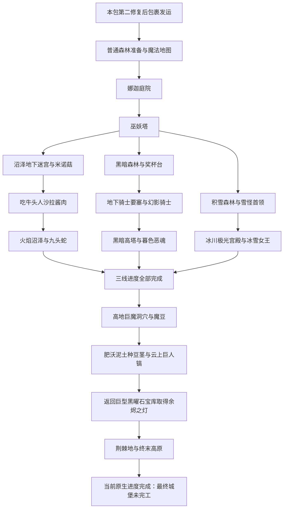

# 暮色森林全流程调查：从入门到当前版本毕业

调查日期：2026-11-07。对象为整合包锁定的 Minecraft 1.20.1 / Twilight Forest **4.3.2508**。本报告调查原生冒险骨架、资源获得与可再生机制，为暮色工业方案重新分期；不注册配方、不确定修复碎片的能力分配。

结论来自发行 Jar 的 JSON、对应映射 Jar 的 Java 字节码静态检查和本包源码。**未实际游玩完整流程，未验证自动农场、服务器存档规则或第三方装备/打包对流程的影响。**

## 1. 调查对象与来源

- 清单：[`manifest/mods.json`](../../manifest/mods.json)，固定 CurseForge 文件 `5468648`，文件名 `twilightforest-1.20.1-4.3.2508-universal.jar`。
- 本机实例原始 Jar 的 SHA-256：`0bdc89263616d1b35c32ef82c5e9c14cbd20368e2fe8b468c72a28320be7a778`。Manifest 的版本为 `4.3.2508`，构建时间为 `2024-06-24T18:00:24+0000`。
- 对应 ForgeGradle 映射缓存的 `.input` 中 `orig` 与原始 Jar SHA-1 一致；两份 Jar 的 **346 个进度、区域限制、结构 JSON 全部一致**。字节码检查使用 `javap -c -p`，不执行游戏。REA 工具未连接，本轮使用普通 ZIP/JSON 和 JDK 工具，未生成 REA Evidence。
- 本包入口与限制：[`玩家包裹发运`](../gameplay/parcel-dimension-dispatch.md)、[`DispatchController.java`](../../mods/dimensionworks-transfer/src/main/java/dev/szx/dimensionworks/transfer/dispatch/DispatchController.java)、[`暮色配置`](../../config/twilightforest-common.toml)、[`拆解台脚本`](../../kubejs/server_scripts/twilight_uncrafting_table.js)。
- 官方 [TeamTwilight 源码](https://github.com/TeamTwilight/twilightforest/tree/1.20.x) 仅辅助定位与解释。`1.20.x` 是移动分支，不能代替锁定发行版；官方 `benimatic.com/tfwiki` 本轮访问超时或 502，未用不明新站替代官方来源。

Jar 内的主要来源索引：

| 来源 | 负责确认的内容 |
| --- | --- |
| `data/twilightforest/advancements/*.json` | 13 个主线/入口节点、29 个其他进度的实际条件；展示父节点与真实前置的区别 |
| `data/twilightforest/twilight/restrictions/*.json` | 9 个受限生物群系的解锁进度与惩罚类型 |
| `data/twilightforest/worldgen/structure/*.json` | 巫妖塔、迷宫、要塞、高塔、雪怪巢穴、宫殿与高地的结构前置 |
| `data/twilightforest/loot_tables/`、`recipes/` | 原材料、工具、战利品与替代配方 |
| `worldgen/biome/`、`worldgen/configured_feature/tree/` | 生物生成定义、树苗接入的地下根生成配置 |
| `ProgressionEvents`、`LandmarkUtil`、`TrophyPedestalBlock`、各 Boss 类 | 玩家保护、奖杯台、多人参战结算与战斗机制 |
| 树木 grower、`TreeRootsDecorator`、`TorchberryPlantBlock`、`Experiment115Block`、魔法树核心 | 原生再生、采收、环境变化与加速行为 |

## 2. 完整主线骨架

暮色不是一条把所有 Boss 按难度顺序排列的直线。**娜迦→巫妖构成共同前段；巫妖后分成三条可自行排序的路线，三线全部完成才汇合到高地。**

图中是正常冒险路线。米诺菇击杀、爬豆茎、杀巨人等操作并非每一步都被进度系统强制检测；下面分别列出真实门槛和替代来源。空心山、谜题羊、树屋等可选内容不塞入此主线。

## 3. 从入门到毕业，玩家具体做什么

| 阶段 | 地点与主要玩法 | 关键产物/工具 | 推进结果 |
| --- | --- | --- | --- |
| 进入前 | 原生暮色通常用水池、植物和钻石开门；本包禁止此门，第二修复后通过中转领地包裹发运 | 已有维度钥匙与发运终端 | 到达暮色即有原生入口进度，不要求再造被禁用的门 |
| 普通森林准备 | 建补给点；探索树屋、空心山、树篱迷宫；收集羽毛、浆果、树苗与根材 | 乌鸦羽毛+火炬浆果+萤石粉→魔法地图核心；核心+8纸→魔法地图 | 魔法地图找主要地标；地图不是地下宝箱坐标或强制首领前置 |
| 娜迦 | 庭院中的高速绕行、冲刺、身体分段；躲避或盾挡后找攻击窗口 | 鳞片、奖杯；鳞片制作胸甲与护腿 | 娜迦进度解除巫妖塔的结构保护 |
| 巫妖 | 登塔、探索侧室；顶部先反弹有效弹体破盾，再应对仆从，最后近战。固定版初始为6盾，不能直接用普通近战跳过盾阶段 | 四种权杖中的掉落、奖杯、装备 | 巫妖进度开放沼泽、黑暗森林和积雪森林；收齐四种权杖是可选收集进度 |
| 沼泽迷宫 | 两层地下迷宫、岔路、危险房间与隐藏宝库；地图辅助定位。米诺菇有冲刺和地面重击 | 米诺陶的迷宫地图核心；钢叶、薄饼、迷宫破坏者；米诺菇的牛头人沙拉酱肉与钻石斧 | **吃** `meef_stroganoff` 才推进到火焰沼泽；只击杀米诺菇并不等于完成该门槛 |
| 九头蛇 | 多部位战斗，躲避火焰、咬击和弹体，在头部张嘴时攻击；固定版装甲路径伤害除以8后取整 | 炽热之血、九头蛇肉、奖杯；血与铁锭合成炽铁 | 完成热区分支，作为三线汇合的一项 |
| 黑暗森林入口 | 先处理生境失明；在要塞入口奖杯台上放受支持的奖杯，解除附近盾墙 | 已有奖杯；不专门要求九头蛇奖杯 | 激活奖杯台进度，进入地下骑士要塞 |
| 幻影骑士 | 地下要塞分区探索；六名骑士的阵型、投掷武器和冲锋窗口 | 盔甲碎片、骑士金属、幻影装备与奖杯 | 骑士进度开放黑暗森林中心和高塔；不是杀掉第一名就结束整个遭遇 |
| 黑暗高塔/暮色恶魂 | 主塔与支塔垂直寻路、塔钥匙、再现方块、反建器、砷铅铁建造平台；塔顶小恶魂与蓄能陷阱参与战斗。恶魂狂暴时固定版伤害除以10 | 蠹虫精华、实验115、砷铅铁、塔钥匙；Boss的炽热之泪与奖杯 | 完成高塔分支；蓄能陷阱具有实战用途，但触发陷阱的可选进度不是 Boss 进度的必需条件 |
| 雪怪首领 | 积雪森林洞穴；初始条件下免疫投射物，近身有效攻击后应对狂暴、落冰与投掷，利用疲劳窗口 | 雪怪首领毛皮、冰炸弹、奖杯 | 首领进度开放冰川；普通极地毛皮不能当作首领毛皮使用 |
| 冰雪女王 | 极光宫殿多翼、高差与跑酷；女王召唤、下砸、冰束三态与冰盾 | 特殊弓、冰雪材料、奖杯 | 完成冰川分支，作为三线汇合的一项 |
| 高地巨魔洞 | 三线完成后调查洞穴花园、巨魔与宝库，找魔豆和肥沃泥土 | 巨魔概率掉魔豆，花园宝箱也有魔豆/肥沃泥土 | 获得上云与开宝库的工具链，不是再解锁一个标准首领战 |
| 云层与回洞 | 魔豆种在 `uberous_soil` 长豆茎；到云层取得巨人镐，再回洞处理巨型黑曜石宝库 | 巨人矿工掉巨人镐；巨人镐另有巨型圆石/原木合成路线；宝库产余烬之灯 | 工具来源不只一条，但余烬之灯正常来自指定巨魔宝库 |
| 荆棘与终末高原 | 普通破坏荆棘会刺激生长，余烬之灯用于烧出通路；抵达城堡区域 | 余烬之灯、焦化后的荆棘与后期建筑材料 | 当前原生进度终点；最终城堡与最终 Boss 流程尚未完成 |

战斗机制已做固定 Jar 静态核对；装备、飞行、自动武器、工业辅助设备怎样影响这些遭遇，仍需完整包实测。不要把上表写成唯一合法战术。

## 4. 真实进度条件：不要只读展示箭头

Minecraft 进度 `parent` 主要组织展示树，不能单独当作强制前置。真正条件由 `criteria` 与 `requirements` 决定：一个内层数组为“任选一项”，多个内层数组之间为“全部满足”。

| 主线 ID（均属 `twilightforest:`） | 实际必要条件摘要 |
| --- | --- |
| `root` | 进入暮色，或原生造门，任选其一 |
| `progress_naga` | 击杀、获得鳞片、获得奖杯、参战结算等路径任选其一 |
| `progress_lich` | 娜迦进度 **且** 巫妖击杀/奖杯/任一权杖/参战结算之一 |
| `progress_labyrinth` | 巫妖进度 **且吃掉** 牛头人沙拉酱肉；没有要求米诺菇击杀条件 |
| `progress_hydra` | 迷宫进度 **且** 九头蛇击杀/奖杯/参战结算之一 |
| `progress_trophy_pedestal` | 巫妖进度 **且** 放置奖杯台触发 |
| `progress_knights` | 奖杯台进度 **且** 全体幻影骑士触发/奖杯/参战结算之一 |
| `progress_ur_ghast` | 骑士进度 **且** 暮色恶魂击杀/奖杯/参战结算之一；不要求 `ghast_trap` 完成 |
| `progress_yeti` | 巫妖进度 **且** 首领击杀/首领毛皮/奖杯/参战结算之一 |
| `progress_glacier` | 雪怪首领进度 **且** 女王击杀/奖杯/参战结算之一 |
| `progress_merge` | 九头蛇、暮色恶魂、冰雪女王三个分支进度 **全部完成** |
| `progress_troll` | 三线汇合进度 **且** 获得余烬之灯；没有再检查种豆或杀巨人 |
| `progression_end` | 余烬之灯阶段进度 **且** 身处 `final_plateau` |

`was_in_fight` 的触发器名为 `hurt_boss`，但检查娜迦、巫妖、九头蛇、恶魂、雪怪、女王等代码后，触发调用位于死亡/结算路径，遍历参与伤害的玩家；幻影骑士另有附近玩家结算。**不能推断打一下立刻获得进度，也不能把进度当作单人亲自击杀证明。**

奖杯和指定掉落的持有路径意味着交易、共同战斗、搬运奖杯可影响解锁；这属于原生多人流程。后续设计需要按本包希望接受的实际工程成果验收，而不是误用某材料或进度作为无法绕过的战斗证明。

## 5. 区域保护与结构保护是两层机制

`tfEnforcedProgression` 在固定版注册默认值为 `true`，`LandmarkUtil.isProgressionEnforced` 读取该游戏规则。仓库未据此证明当前服务器存档也为 `true`；实际存档值未调查。

| 生物群系 | 所需进度 | 未解锁的生境惩罚 | 结构另需满足的前置 |
| --- | --- | --- | --- |
| `swamp` | 巫妖 | 饥饿/蚊群主题 | 迷宫：巫妖 |
| `fire_swamp` | 迷宫/吃沙拉酱肉 | 着火 | 九头蛇巢穴：迷宫 |
| `dark_forest` | 巫妖 | 黑暗/失明 | 骑士要塞：奖杯台 |
| `dark_forest_center` | 骑士 | 黑暗/失明 | 黑暗高塔：骑士 |
| `snowy_forest` | 巫妖 | 冰霜效果 | 雪怪巢穴：巫妖 |
| `glacier` | 雪怪首领 | 更强冰霜效果 | 极光宫殿：雪怪首领 |
| `highlands` | 三线汇合 | 酸雨 | 巨魔洞穴：三线汇合 |
| `thornlands` | 余烬之灯阶段 | 酸雨；荆棘另有自身行为 | 最终城堡：余烬之灯阶段 |
| `final_plateau` | 余烬之灯阶段 | 酸雨 | 最终城堡：余烬之灯阶段 |

巫妖塔没有对应的整片森林生境惩罚，但结构要求娜迦进度。区域内的箱子、按钮、拉杆等交互以及破坏、攻击也可能被结构保护阻止。穿抗火装备、喝药水、飞过地表并不会自动改变结构所需进度。

本包发运调用 TF 的安全坐标重定位，并在落点检查中读取进度保护；它不授予上述 Boss 进度。另一项重要边界是 `ProgressionEvents.isAreaProtected` 对 Forge `FakePlayer` 有豁免分支：**玩家不能采集，不代表机器一定不能采集。** Create 自动采掘、部署器、CMP 方块/实体搬运、转换粉和其他模组机制必须逐项游戏验证，不能把区域保护当成工业材料的绝对锁。

## 6. 按来源调查资源，而不是按装备等级猜分期

| 来源阶段 | 材料、生物与设备 | 持续获得判断 |
| --- | --- | --- |
| 普通森林与洞穴 | 原木、叶、树苗、活根、浆果；鹿、野猪、大角羊、乌鸦、松鼠、矮兔、小鸟 | 树与浆果已有原生持续路径；鹿/野猪有繁殖代码，大角羊继承羊；乌鸦不可原生繁殖且羽毛为击杀掉落 |
| 空心山 | 钢叶、铁木、矿石磁铁、转换粉、护符与普通矿物 | 钢叶在 `chests/hill_1` 和 `hill_3` 都有，不能用它证明已完成迷宫。矿物与箱子需区分种树、刷怪、采矿和继续找新结构 |
| 树中宝藏 | 时光、变化、矿石、分类四种魔法树苗 | `chests/tree_cache` 已含四种树苗；没有可靠的 Boss 阶段硬锁，稀有度与实际结构获取需实测 |
| 沼泽迷宫 | 钢叶、迷宫地图核心、薄饼、迷宫破坏者、沙拉酱肉 | 核心有米诺陶掉落，其他物品分别核对战利品表；箱子产物不能直接算成可再生，Boss材料也不等同普通怪物掉落 |
| 骑士要塞 | 盔甲碎片、骑士金属、幻影装备 | 寄居蟹、链锤哥布林、哥布林骑士等掉碎片；9碎片→碎片簇→熔炼/高炉骑士金属，存在非 Boss 生物来源 |
| 黑暗高塔 | 蠹虫精华、砷铅铁、实验115、塔钥匙和机关 | 蠹虫精华由塔木蠹虫掉落；4精华+4红石+1恶魂之泪→砷铅铁。钥匙与食物宝箱是探索来源，机关另有合成配方 |
| 热区/高塔首领 | 炽热之血、炽热之泪、炽铁 | 血或泪与铁锭合成炽铁；普通恶魂之泪不等于炽热之泪。重复首领收益不应被称作已验证的自动农场 |
| 雪林/冰川 | 极地毛皮、首领毛皮、冰炸弹、企鹅、冰核与冰雪材料 | 普通毛皮与首领毛皮分开；企鹅有覆写繁殖行为，不能把乌鸦的不可繁殖规则套到所有鸟上 |
| 高地/云层 | 魔豆、肥沃泥土、巨魔石、巨型块、巨人镐、余烬之灯 | 魔豆有巨魔掉落和花园箱来源；巨人镐有掉落和合成；灯来自指定宝库；巨型块可拆成64个普通块 |

### 6.1 两条已经存在的环境再生路径

**树苗→地下活根。** `SmallOakTreeGrower`、`CanopyTreeGrower`、`MangroveTreeGrower` 接入对应树配置；`TreeRootsDecorator` 通过 `FeaturePlacers.traceRoot/traceExposedRoot` 放根，位置由 `FeatureLogic.canRootGrowIn` 检查。暮色橡树和苍穹树配置的普通根:活根方块权重为6:1，红树为4:1。权重不等于每棵树固定产量；该调用链未限定仅自然世界生成，也未限定暮色维度。

这已经构成原生种树产活根路径。实际地下介质、机械采根与回种净收益、其他维度种植表现尚未实测。后续应先测试现有林场能否接入，而非默认必须创造一套活根自增配方。

**骨粉→火炬浆果恢复。** `TorchberryPlantBlock.use` 摘1个并清空 `HAS_BERRIES`；无果时接受骨粉，`performBonemeal` 恢复果实。存在补骨粉—采收循环；没有据此观察到自然随机再生。部署器/农业附属的采收兼容与骨粉供应收支需要实测。

### 6.2 三类容易误判的特殊机制

- **实验115**：完整八片状态用红石激活再生，随机 tick 恢复切片。它是已有再生食品，不等于无限可提取的工业物品；再生状态下不能正常潜行拆回物品，吃尽最后一片也可能移除方块。不要把“可重复吃”直接转换成任意自动原料来源。
- **谜题羊**：16色羊毛齐全后结算一次并保存领奖状态；不可原生繁殖。奖励含碎裂号角、奖杯与资源块。运来一只羊有收集/物流价值，不代表它是常驻无限资源机。
- **转换粉**：鹿↔牛、野猪↔猪、大角羊↔羊、企鹅↔鸡、乌鸦↔蝙蝠、米诺陶↔僵尸猪灵、塔木蠹虫↔蠹虫、塔恶魂守卫↔恶魂等有可逆配方。生物自然所在区域不是其唯一潜在获得途径；转换前后的状态与工业周期不能凭空假定保留。

### 6.3 魔法树会改变工业条件

| 核心 | 固定版代码行为 | 对后续设计的影响 |
| --- | --- | --- |
| 时光 | 调用随机方块 tick，也能调用方块实体 ticker | 有机器加速路径，必须审查与额度、产能和服务器 tick 开销的交互 |
| 矿石 | 调用矿石磁铁搬移现有矿物 | 是搬运矿物，不是生成矿物；不能作为无限矿源 |
| 分类 | 扫描方块/实体的物品处理器并搬运物品，使用 Forge `ITEM_HANDLER` | 可能成为实际物流工具；不能只按普通装饰树处理 |
| 变化 | 改写区域生物群系数据为魔法森林并更新区块 | 人工改生境可能影响环境条件；“魔法森林”不能天然充当不可伪造的进度凭证 |

代码默认启用这些核心，不代表当前服务器配置与运行行为已核实。树苗有早期战利品来源，不能将这些作用不经审查地塞进后期升级或低成本加速奖励。

## 7. 可选流程与收藏，全部纳入调查范围

主线之外的内容会影响资源和工具选择，但不应全部变成强制关卡：

| 支线 | 具体内容 | 对工业调查的意义 |
| --- | --- | --- |
| 小/中/大空心山 | 矿物、宝箱、刷怪笼和不同地牢敌人 | 早期钢叶、护符与样本来源，可能打破按首领猜测的材料分期 |
| 树篱迷宫 | 路径、宝箱、蜘蛛与树篱危险 | 初期可选战斗/资源点，不承担巫妖后主线门槛 |
| 空心树与树中房间 | 垂直探索、蛛网与宝藏 | 魔法树苗及其他特殊物品来源，需关注获取而非直接硬锁 |
| 魔法森林谜题羊 | 收集16色羊毛与一次性领奖 | 原生收集/物流任务，应与新增工业考核去重 |
| 蘑菇塔、遗迹、水井、小屋等 | 地标、建筑与生态内容 | 结构存在不等于新增科技阶段，工业来源需落实到真实掉落/采集 |
| 地图升级 | 魔法地图、迷宫地图、矿石地图；迷宫地图核心与原生工具 | 减轻寻路或定位成本，不强制所有地图都制作；矿石地图有矿物块成本 |
| 装备与特殊工具 | 娜迦胸甲/护腿、四权杖、炽铁装备、幻影装备、染色极地装备、玻璃剑、特殊弓、迷宫破坏者、生命/保管护符 | 是各分支奖励与不同解法，不能机械压成单线装备梯度 |
| 食品与挑战 | 暮色饮食收集、九头蛇肉、实验115及重复进食、药水生存挑战 | 可能提供补给或收藏，不能误算为主线必需在线时间 |
| 树木收藏/拆解 | 林业全收集、原生拆解相关进度 | 本包拆解台被禁用；原版进度存在不证明本包可完成 |

### 全部42个非配方进度索引

主线/入口13项已在第4节列出。其余29项逐项登记如下；这里的分组是调查用途，不改原生进度：

- 地牢与猎取：`hedge`、`hill1`、`hill2`、`hill3`、`twilight_hunter`。
- 地图与寻宝：`magic_map_focus`、`magic_map`、`maze_map`、`ore_map`、`mazebreaker`。
- 特殊结构、机关与后期工具：`quest_ram`、`ghast_trap`、`troll`、`beanstalk`、`giants`。
- 装备、饮食与其他挑战：`naga_armors`、`lich_scepters`、`fiery_set`、`arctic_armor_dyed`、`break_glass_sword`、`hydra_chop`、`full_mettle_alchemist`、`twilight_dinner`、`experiment_115`、`experiment_115_115`、`experiment_115_self_replenishing`、`kill_cicada`。
- 全量林业/拆解：`arborist`、`uncraft_uncrafting_table`。

两个特别不能误读的例子：`giants` 的展示描述提巨人镐，但固定 JSON 的 `pickaxe` 条件实际上检查魔豆；`twilight_hunter` 的候选表中有技术/未完成实体，不代表要求逐一猎杀所有候选。不能用标题、候选列表或展示父节点代替实际条件。

## 8. 如何据此重做暮色工业方案

新方案先建立 **冒险阶段→开放环境/工具→原生资源→加工能力→持续用途** 的对照关系，再决定新材料和工艺。前版“林业—浸出—生物—精制—回用”保留为候选，尚不能作为脱离原生流程的固定章节。

1. **共同前段**：先考虑普通森林、原生林场活根、骨粉浆果、可繁殖动物和地图准备。早期钢叶/魔法树苗必须纳入替代来源审计；不要默认所有材料都需新增自增配方。
2. **巫妖后三分支**：分别围绕沼泽迷宫、骑士要塞/高塔、雪林/冰川的实际生态与机制选择工业问题，允许玩家选择推进次序。每条支线要有不同操作与长期用途，不能仅把三个 Boss 掉落换成三个合成格。
3. **高地汇合**：利用三线已有产物、不同现场供应及工具链形成综合工厂问题；区分真实进度门槛和交易/转换/合成等替代路径。不能提前要求尚未开放的高地材料来制造前段唯一设备。
4. **当前毕业**：原生已完成内容止于终末高原。新增工业毕业应明确是本包工程目标，不冒称击败尚未完成的最终 Boss；保留各分支资源的持续需求。
5. **20～30小时重新估算**：原生探索与战斗不计入新增工业时长；按各阶段的新增建设、实验、物流和优化任务试玩统计，旧五阶段时间表暂不作为定稿依据。

这确定了方案应该依附的骨架，尚未决定“必须打每个 Boss 才能生产所有材料”、新增材料名单或碎片配方。是否需要额外强制门槛，应由原生资源审计与具体工程目标支持，不能为了堵捷径先删除原机制。

## 9. 已确认与仍需验证

已完成：固定版本身份核对、42个非配方进度范围登记、主线条件与三线汇合、9个生境限制与相关结构前置、8个主要 Boss 的核心战斗区别、后期工具链、可选内容、重要原生再生与替代材料来源的静态调查。

尚未完成：完整包实际游玩、存档游戏规则、各材料真实净产率、自动采收与跨维种植、转换后的状态、魔法树/飞行/机器/CMP 绕过表现、首领重复获取与服务器性能。正式配方/阶段锁定前先测直接影响该方案的事项，不要求无收益地穷举所有装饰物或重复收集进度。
